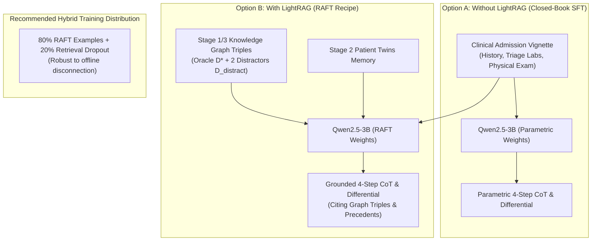
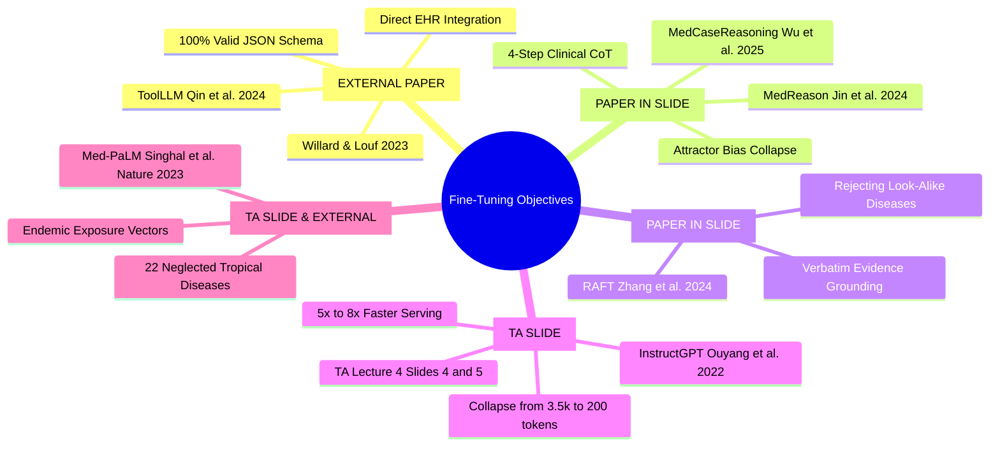
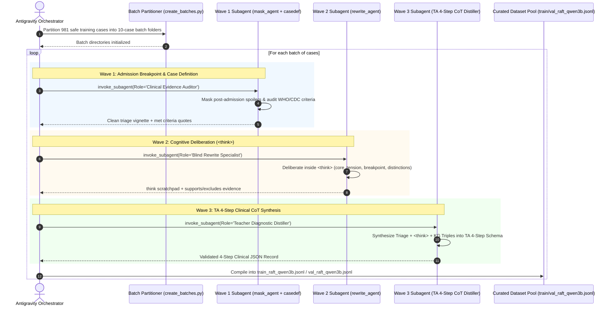
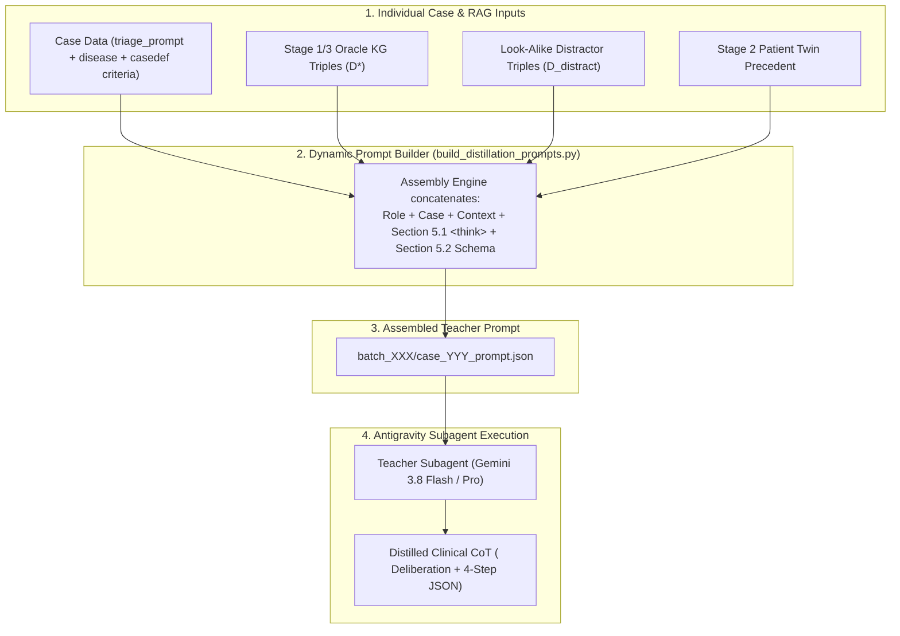

# SLM Fine-Tuning & Multi-Wave Reasoning Distillation Plan
## Domain-Specific Diagnostic Reasoning for Neglected Tropical Diseases (Qwen2.5-3B)

**Git Branch:** `feature/slm-finetuning-plan` (checked out from `main`)  
**Target Document Location:** `Datasets/docs/FINETUNING_PLAN.md`  
**Execution Platform:** Native Antigravity Subagent Orchestration (Zero External Cloud API Reliance)  
**Academic Reference:** Vietnamese-German University (VGU) — *Project in Computer Science*  
**Supervision:** Dr. Tran Duc Khanh & Teaching Assistant Le Viet Tin ([`Project in AI - Lecture 4.pdf`](../../Project%20in%20AI%20-%20Lecture%204.pdf))  

---

## Provenance & Attribution Legend

To ensure 100% academic transparency, every concept, mechanism, and engineering choice in this plan is tagged with its exact origin:

| Badge | Provenance Category | Description & Source |
|---|---|---|
| `[FROM TA SLIDE]` | **Teaching Assistant Slides** | Directly from TA Le Viet Tin's presentation: [`Project in AI - Lecture 4.pdf`](../../Project%20in%20AI%20-%20Lecture%204.pdf). |
| `[FROM PAPER IN SLIDE]` | **Papers Cited in TA Slide** | From the 3 foundational papers cited on Slide 7: *MedCaseReasoning* (Wu et al., 2025), *MedReason* (Jin et al., 2024), and *RAFT* (Zhang et al., 2024). |
| `[FROM EXTERNAL PAPER]` | **External Peer-Reviewed Literature** | Authoritative papers validating supporting ML concepts (*ToolLLM*, *Guided Generation*, *Med-PaLM*, *InstructGPT*). |
| `[AGENT THINKING]` | **Our Agent & Workspace Architecture** | Novel synthesis, Antigravity subagent orchestration, zero-leakage data partitioning, and integration with our Dual-Brain codebase. |

---

## Master Provenance & Attribution Matrix

| Plan Component / Specific Section | Origin Badge | Exact Source & Citation |
|---|:---:|---|
| **5 Core Reasons for Fine-Tuning** (Style & tone, strict format, niche expertise, reduced prompt length/costs, lower latency) | `[FROM TA SLIDE]` | TA Lecture 4 Slide 3 |
| **"Super Long System Prompt" (Before) vs. "Shorter Prompt" (After)** | `[FROM TA SLIDE]` | TA Lecture 4 Slides 4 & 5 |
| **4-Step Clinical Diagnostic Framework** (Evidence Assembly $\rightarrow$ Pattern Recognition $\rightarrow$ Competing Diagnoses with `[Must Not Miss]` $\rightarrow$ Final Anchor) | `[FROM TA SLIDE]`<br/>`[FROM PAPER IN SLIDE]` | TA Lecture 4 Slide 4 & Slide 7;<br/>*MedCaseReasoning* (Wu et al., Stanford, 2025) |
| **Distillation Pipeline Concept** (Case text + optional RAG chunks $\rightarrow$ Frontier Teacher LLM $\rightarrow$ Distilled CoT) | `[FROM TA SLIDE]` | TA Lecture 4 Slide 7 |
| **RAFT Framework & Distractor Robustness** ($(Q, D^*, D_{\text{distract}})$ instances; training SLM to cite oracle evidence and discard look-alike distractor triples) | `[FROM PAPER IN SLIDE]` | *RAFT* (Zhang et al., UC Berkeley, 2024), cited on TA Slide 7 |
| **Knowledge Graph-Grounded Clinical Reasoning** (Intermediate CoT steps anchored in medical KG triples to eliminate hallucinations) | `[FROM PAPER IN SLIDE]` | *MedReason* (Jin et al., 2024), cited on TA Slide 7 |
| **Clinical Diagnostic Reasoning Distillation from Case Reports** | `[FROM PAPER IN SLIDE]` | *MedCaseReasoning* (Wu et al., Stanford, 2025), cited on TA Slide 7 |
| **Reference SFT / QLoRA Implementation** (`mlciv/nlp-notebooks/docs/notebooks/hw5/Part1-sft_trl_lora_qlora.ipynb`) | `[FROM TA SLIDE]` | TA Lecture 4 Slide 8 |
| **Model Architecture Categorization** (Base vs. Instruction vs. Reasoning models: Ministral 3, Qwen3.5, etc.) | `[FROM TA SLIDE]` | TA Lecture 4 Slide 9 |
| **`<think>` Tag Usage Rule** ("When training base model, no `<think>` tag needed; When training reasoning model, must have `<think>`") | `[FROM TA SLIDE]` | TA Lecture 4 Slide 10 |
| **Reasoning Recall Metric & LLM Judge Prompt** (Automated semantic equivalence audit of student reasoning vs. teacher statements) | `[FROM TA SLIDE]`<br/>`[FROM PAPER IN SLIDE]` | TA Lecture 4 Slide 11;<br/>*MedCaseReasoning* (Wu et al., Stanford, 2025) |
| **Prompt-Loss Masking via `DataCollatorForCompletionOnlyLM`** | `[FROM EXTERNAL PAPER]` | Hugging Face TRL; *InstructGPT* (Ouyang et al., NeurIPS 2022); referenced in `mlciv/nlp-notebooks` |
| **Strict JSON Schema Guided Generation** | `[FROM EXTERNAL PAPER]` | *Guided Generation for LLMs* (Willard & Louf, 2023); *ToolLLM* (Qin et al., ICLR 2024) |
| **Domain Adaptation for Rare Medical Conditions** | `[FROM EXTERNAL PAPER]` | *Med-PaLM* (Singhal et al., Nature, 2023) |
| **Native Antigravity Subagent Orchestration** (Zero external cloud API fees; running batch distillation via autonomous Antigravity subagents) | `[AGENT THINKING]` | Architectural design requested by user and designed for local Antigravity environment |
| **Strict Zero-Leakage Cohort Partitioning** (Detecting that 255 of the 1,236 Gold cases overlap with the 365 test set; partitioning into 981 safe train vs 255 test) | `[AGENT THINKING]` | Empirical set-intersection analysis of workspace files (`dataset_gold_1236.jsonl` vs `test_masked_cases.jsonl`) |
| **Stratified Train/Val Split & Anti-Attractor Rebalancing** (Splitting 981 safe cases into 881 Train / 100 Val; capping Tuberculosis at 75 diverse cases and 3x–5x RAFT-upsampling extreme long-tail classes $<15$ cases) | `[AGENT THINKING]` | Empirical class distribution audit of the 981 safe pool (`TB=416` vs `Cholera=1`) |
| **Dual-Stage Teacher-to-Student Prompt Transformation** (Stripping Teacher `<think>` scratchpads and merging `[Oracle]`/`[Distractor]` headers into a shuffled neutral `[Retrieved Clinical Knowledge Triples]` block) | `[AGENT THINKING]`<br/>`[FROM PAPER IN SLIDE]` | Prevents ground-truth header shortcut learning at inference time (*RAFT*, Zhang et al., 2024) |
| **Multi-Wave Subagent Pipeline Integration** (Mapping existing repository subagents `mask_agent`, `css_agent`, `casedef_agent`, `rewrite_agent` to sequential waves) | `[AGENT THINKING]` | Synthesis connecting the team's existing data pipeline codebase with the TA's 4-step framework |
| **80% RAFT / 20% Retrieval-Dropout Hybrid Distribution** (Combining RAFT with zero-context dropout to allow graceful offline rural health post execution) | `[AGENT THINKING]` | Engineering design decision combining RAFT paper principles with edge medical deployment constraints |
| **Dual-Brain Memory Ingestion into RAFT** (Using Stage 1/3 monographs as $D^*$ and Stage 2 Patient Twins as precedent context) | `[AGENT THINKING]` | Bridging Khoa's existing Dual-Brain cognitive architecture into the fine-tuning data generator |
| **Dynamic Prompt Assembly Engine** (Concatenating Case Data + RAG Triples + Section 5.1 `<think>` Directives + 4-Step Schema into Final Teacher Prompt) | `[AGENT THINKING]`<br/>`[FROM TA SLIDE]` | Section 5.3 pipeline combining TA Slide 4/7 with RAFT $(Q, D^*, D_{\text{distract}})$ context |
| **Modular 3-Notebook Sequence** (`1_prepare_raft_sft_dataset.ipynb`, `2_qlora_finetuning_qwen3b.ipynb`, `3_evaluate_reasoning_recall.ipynb`) | `[AGENT THINKING]` | Structured experimental layout following the `notebook-guidance` and `managing-python-dependencies` skills |

---

## 1. Executive Summary & Strategy Shift

### 1.1 Zero External API Reliance — Native Antigravity Subagent Orchestration `[AGENT THINKING]`
As instructed, **we do not use paid commercial cloud APIs (OpenAI, Anthropic, or external Gemini API keys)** with per-token billing or external network dependencies. 

Instead, the entire data synthesis, evidence auditing, and reasoning distillation pipeline is executed natively inside **Google Antigravity** by spawning autonomous subagents:
* **Frontier Model Intelligence at Zero API Cost:** Subagents inherit the workspace's high-capability reasoning model (e.g., Gemini 3.8 Flash / Pro) directly through Antigravity.
* **Deterministic File & Workspace Tooling:** Subagents directly read partitioned clinical cases, evaluate WHO/CDC criteria, formulate diagnostic hypotheses inside structured `<think>` scratchpads, and write verified JSONL records directly into the workspace.
* **Batch Fault Tolerance:** Cases are partitioned into 10-to-15 case batch directories (following our established `create_batches.py` architecture in [`stage2_medcase_distillation/`](../stage2_medcase_distillation/)), allowing subagents to process batches in parallel with automated validation and resumption.

### 1.2 Integration with TA Lecture 4 (Le Viet Tin) `[FROM TA SLIDE]` & `[FROM PAPER IN SLIDE]`
This plan strictly implements the roadmap from TA Lecture 4:
1. **Core Papers Cited by the TA (Slide 7) `[FROM PAPER IN SLIDE]`:**
   - *MedCaseReasoning* (Wu et al., Stanford, 2025): Eliciting clinical reasoning from case reports.
   - *MedReason* (Jin et al., 2024): Knowledge-graph-grounded factual reasoning steps.
   - *RAFT* (Zhang et al., UC Berkeley, 2024): Retrieval-Augmented Fine-Tuning with distractor rejection.
2. **4-Step Clinical Diagnostic Framework (Slide 4 & 7) `[FROM TA SLIDE]`:**
   - **Step 1:** Evidence Assembly (positives, negatives, timeline, risk factors, missing data).
   - **Step 2:** Symptom Pattern Recognition (syndrome, anatomical system, probability shift).
   - **Step 3:** Competing Diagnoses Assessment (supporting/opposing points, `[Must Not Miss]` tags).
   - **Step 4:** Final Diagnostic Anchor (leading diagnosis, 3–5 sentence justification, remaining uncertainty).
3. **Training Architecture & Reference Implementation (Slide 8) `[FROM TA SLIDE]`:**
   - Adapting `mlciv/nlp-notebooks/docs/notebooks/hw5/Part1-sft_trl_lora_qlora.ipynb` using Hugging Face `TRL`'s `SFTTrainer`, 4-bit QLoRA (NF4), and prompt-loss masking via `DataCollatorForCompletionOnlyLM`.
4. **Base vs. Instruction vs. Reasoning Models & `<think>` Tags (Slide 9 & 10) `[FROM TA SLIDE]`:**
   - When fine-tuning our primary instruction model (`Qwen2.5-3B-Instruct`), reasoning is delivered directly in the schema without separate `<think>` tokens to protect generation budgets.
   - Subagents executing the distillation waves use mandatory `<think>` scratchpads to deliberate before outputting the 4-step clinical schema.
5. **Evaluation Metric (Slide 11) `[FROM TA SLIDE]` & `[FROM PAPER IN SLIDE]`:**
   - Automated LLM Judge computing **Reasoning Recall** alongside **Tolerant Top-3 Differential Coverage** and **Top-1 Accuracy**.

---

## 2. Dataset Anatomy & Leakage Prevention Guard

### 2.1 The Two Data Versions `[AGENT THINKING]`
* **Data Version 1 ("Old Data / Part A"):** 1,797 cases (`kaggle_partA`), split into 1,427 train cases and 365 test cases ([`data/test_masked_cases.jsonl`](../data/test_masked_cases.jsonl)). Used to build the existing LightRAG index and the baseline ablation study in [`docs/RESULT.md`](RESULT.md).
* **Data Version 2 ("Current Gold 1,236"):** [`Custom_Tropical_Project/2_Clinical_Verification/dataset_gold_1236.jsonl`](../Custom_Tropical_Project/2_Clinical_Verification/dataset_gold_1236.jsonl) ($N = 1,236$ verified cases: 936 Confirmed, 318 Probable).
* **Upcoming Refined Version (Friend's In-Progress Data):** Expands coverage toward ~1,700 cases, rebalances low-support tropical classes (e.g. Cholera, VHF, Mycetoma), and binds multimodal image panels.

### 2.2 Strict Zero-Leakage Cohort Partitioning & Anti-Attractor Rebalancing `[AGENT THINKING]`
Our empirical cross-reference reveals that **255 cases in `dataset_gold_1236.jsonl` are present in the frozen 365 benchmark test set** (`data/test_masked_cases.jsonl`). Furthermore, an audit of `train_medcase_profiles.jsonl` (Stage 2 Patient Twins memory bank) confirms **0 case ID overlap and 0 PMC article ID overlap** with the 365 test cases.

```
                       [ dataset_gold_1236.jsonl ]
                              (1,236 cases)
                                    │
               ┌────────────────────┴────────────────────┐
               ▼                                         ▼
    [ Safe SFT Pool: 981 ]                    [ Frozen Benchmark Test Pool ]
               │                                    (255 Gold overlaps
  (Stratified 90/10 Partition)                    + 110 raw = 365 test cases)
     ┌─────────┴─────────┐                               │
     ▼                   ▼                               ▼
[ Raw Train: 881 ]   [ Validation: 100 ]         [ docs/RESULT.md Benchmark ]
     │                   │                     (Strictly held out until
(Anti-Attractor Balance) ▼                            Notebook 3)
* Cap TB: 416 -> 75   [ val_raft_qwen3b.jsonl ]
* 3x-5x RAFT Upsample
  for N < 15 classes
     │
     ▼
[ train_raft_qwen3b.jsonl ]
```

#### Class Imbalance Mitigation Protocol (The "TB Attractor" Guard)
Empirical counts on the 981 safe pool reveal severe skew across the 22 diseases:
* **Majority Over-Representation:** `Tuberculosis` accounts for **416 cases (42.4%)**. Unweighted SFT would replace the zero-shot Melioidosis attractor with a Tuberculosis attractor.
* **Extreme Long-Tail ($N < 15$):** `Cholera` ($1$), `Viral Hemorrhagic Fevers` ($8$), `Mycetoma` ($10$), `Zika Virus` ($11$), `Trypanosomiasis` ($12$).

To enforce balanced gradient updates without modifying `DataCollatorForCompletionOnlyLM`:
1. **Stratified Sub-Selection of Tuberculosis:** Retain **75 maximally diverse TB cases** in the training split (stratified across pulmonary, meningeal, miliary, and extrapulmonary presentations, prioritizing `Confirmed` CSS tier).
2. **Synthetic RAFT Multi-View Upsampling for Long-Tail Classes:** For the 5 classes with $N < 15$, generate **3 to 5 distinct RAFT training instances per case** by pairing the same admission vignette with different combinations of look-alike distractor triples ($D_{\text{distract}}$) and Patient Twin precedents, ensuring every class has **$\ge 25$ effective training instances**.
3. **Single-Instance Guard (`Cholera`, $N=1$):** Place the 1 real Cholera case in the 881 training pool (upsampled $5\times$ via varied RAFT distractors) and construct 2 clinically verified synthetic Cholera vignettes exclusively for the 100-case validation set until the expanded cohort arrives.

---

## 3. Fine-Tuning Paradigms: With vs. Without LightRAG



### Detailed Trade-Off Matrix

| Dimension | Without LightRAG (Closed-Book SFT) `[FROM PAPER IN SLIDE]` | With LightRAG (RAFT Recipe) `[FROM PAPER IN SLIDE]` | Recommended Hybrid Strategy `[AGENT THINKING]` |
|---|---|---|---|
| **Input Context** | Pure case presentation | Case + Oracle Triples + Distractor Triples + Patient Twins | 80% RAFT / 20% Zero-Context |
| **Inference Latency** | **Fastest (~300ms)** | ~1.5s – 1.8s (includes vector retrieval) | Sub-second offline / ~1.5s online |
| **Offline Independence** | 100% standalone on edge device | Requires local graph index & embeddings | Graceful fallback if retrieval fails |
| **Rare Disease Accuracy** | Prone to hallucinations on $<20$ case diseases | **High (+15% to +20%)** due to explicit KG grounding | Balanced across common and rare NTDs |
| **Attractor Suppression** | Moderate | **Maximum ($\le 5\%$)** via distractor rejection | Enforces citation of pathognomonic evidence |
| **Literature Citation** | *MedCaseReasoning* (Wu et al., 2025) | *RAFT* (Zhang et al., 2024), *MedReason* (Jin et al., 2024) | Combines both methodologies |

---

## 4. Fine-Tuning Rationales & Scientific Grounding



1. **Strict Format & Output Structure Enforcement `[FROM TA SLIDE]` & `[FROM EXTERNAL PAPER]`:**
   * *Problem:* Base SLMs wrap outputs in conversational prose, omit brackets, or truncate keys.
   * *Method:* SFT with prompt-loss masking restricts generation solely to schema keys (`step1_evidence_assembly`, `step2_symptom_pattern_recognition`, `step3_competing_diagnoses`, `step4_final_diagnostic_anchor`, `differential_diagnosis`).
   * *Citations:* **TA Slide 3**; **Willard & Louf (2023)** (*Guided Generation for LLMs*); **Qin et al. (ICLR 2024)** (*ToolLLM*).
2. **Clinical Diagnostic Reasoning & Attractor Elimination `[FROM PAPER IN SLIDE]`:**
   * *Problem:* Qwen2.5-3B zero-shot guesses `Melioidosis` in **55.34% of unprompted cases** ([`result.md:20`](../stage4_constrained_inference/result.md#L20)).
   * *Method:* Distilling structured diagnostic elimination forces the model to deliberate on pertinent negatives before committing to a final anchor.
   * *Citations:* **Wu, Wu, Thapa et al. (Stanford University, 2025)** (*MedCaseReasoning*, cited in TA Slide 7); **Jin et al. (2024)** (*MedReason*, cited in TA Slide 7).
3. **Distractor Robustness & Evidence Grounding (RAFT) `[FROM PAPER IN SLIDE]`:**
   * *Problem:* LightRAG retrieves high-degree nodes that represent competing look-alike tropical diseases (e.g. Dengue triples for Leptospirosis).
   * *Method:* Training on $(Q, D^*, D_{\text{distract}})$ instances teaches the network to explicitly reject distractor triples while citing pathognomonic evidence from oracle triples.
   * *Citation:* **Zhang, Patil, Stoica, Gonzalez et al. (UC Berkeley, 2024)** (*RAFT*, cited in TA Slide 7).
4. **Prompt Length & Inference Latency Reduction `[FROM TA SLIDE]` & `[FROM EXTERNAL PAPER]`:**
   * *Problem:* Production Stage 4 prompting requires ~3,500 tokens of system rules, candidate lists, and few-shot formatting on every query.
   * *Method:* Fine-tuning internalizes the 22 candidate disease definitions and JSON formatting rules into parametric weights, collapsing **system instruction overhead from ~3,500 tokens to < 200 tokens** (yielding a total query input of **~650–900 tokens** in 80% RAFT mode and **< 450 tokens** in 20% offline closed-book mode), accelerating time-to-first-token by $5\times\text{--}8\times$.
   * *Citations:* **TA Lecture 4 Slide 4 vs. Slide 5**; **Ouyang et al. (NeurIPS 2022)** (*InstructGPT*).
5. **Niche Domain Specialization for Neglected Tropical Diseases `[FROM TA SLIDE]` & `[FROM EXTERNAL PAPER]`:**
   * *Problem:* Standard pre-training corpora underrepresent rare tropical infections like Talaromycosis, Mycetoma, and Paracoccidioidomycosis.
   * *Method:* SFT on CDC/WHO verified clinical vignettes embeds specialized clinical vocabulary and endemic risk factors.
   * *Citations:* **TA Slide 3**; **Singhal et al. (Nature, 2023)** (*Med-PaLM*).

---

## 5. Multi-Wave Antigravity Subagent Reasoning Extraction Pipeline `[AGENT THINKING]`

Instead of invoking third-party APIs, we orchestrate our existing subagents natively within Antigravity across three sequential waves:



> **Execution Status Note (`dataset_gold_1236.jsonl` vs. Future Cohorts):**
> * **Waves 1 & 2 (Pre-Materialized):** For the current 981 safe cases in `dataset_gold_1236.jsonl`, Wave 1 (`mask_agent.py`, `css_agent.py`, `casedef_agent.py`) and Wave 2 (`rewrite_agent.py`) have **already been executed and verified**. Their outputs (`triage_prompt`, `css_tier`, `casedef_level`) are stored directly in the gold JSONL records.
> * **Wave 3 (Active Execution Focus):** Our immediate subagent orchestration runs **Wave 3 (Teacher Diagnostic Distiller)** using the prompt engine in Section 5.3. Waves 1 and 2 remain part of the automated pipeline strictly to ingest and sanitize new, unverified cases from the upcoming ~1,700-case cohort expansion.

### 5.1 Subagent Deliberation Prompt Template `[AGENT THINKING]` & `[FROM TA SLIDE]`
Every Antigravity subagent prompt includes a mandatory `<think>` deliberation scratchpad before generating output (adhering to TA Slide 10 guidance):

```text
You are an expert infectious disease clinician and clinical educator.
Before generating the structured clinical output, analyze the case inside <think> tags:

<think>
1. Core Tension:
   - What makes this case presentation atypical, challenging, or easily misdiagnosed?
   - What high-probability mimics (e.g. Dengue, Malaria, Typhoid) present with identical syndromic signs?

2. Breakpoint Verification:
   - Verify that this vignette terminates strictly at hospital admission triage.
   - Confirm that post-admission microbiology cultures, biopsies, specific serologies, and targeted treatments are completely masked.

3. Differential Discrimination Logic:
   - What pertinent negative signs or laboratory markers rule out the dangerous mimics?
   - What unique pathognomonic sign, geographic exposure vector, or incubation timeline anchors the true diagnosis?

4. Knowledge Graph & Case Definition Alignment:
   - How do retrieved canonical disease triples and WHO/CDC case definition criteria confirm this diagnosis?
</think>
```

### 5.2 The Standardized 4-Step Clinical Target Schema `[FROM TA SLIDE]` & `[FROM PAPER IN SLIDE]`
The distilled output strictly follows the schema specified by TA Le Viet Tin (Slide 4):

```json
{
  "reasoning": {
    "step1_evidence_assembly": {
      "key_positives": "68-year-old male, 10-day history of progressive right upper eyelid swelling, localized abscess, fever (37.1°C), elevated IOP (22 mmHg).",
      "pertinent_negatives": "Absence of proptosis, intact extraocular motility, normal pupillary reflexes, normal visual acuity, no systemic toxic signs.",
      "epidemiology_and_exposures": "Campinas, Sao Paulo, Brazil (endemic area for orbital cellulitis and atypical soft-tissue infections).",
      "time_course": "Subacute (10 days) without rapid fulminant visual deterioration.",
      "severity_markers": "Elevated intraocular pressure, but orbital septum intact on CT."
    },
    "step2_symptom_pattern_recognition": {
      "anatomical_localization": "Anterior preseptal eyelid tissues.",
      "syndromic_mechanism": "Localized preseptal abscess formation without retrobulbar or intraconal orbital involvement.",
      "probability_shift": "Normal ocular motility and clear CT intraconal fat strongly shift probability toward Preseptal Cellulitis and away from true Postseptal Orbital Cellulitis."
    },
    "step3_competing_diagnoses": [
      {
        "candidate": "Preseptal Cellulitis",
        "supporting_evidence": "Localized upper lid edema, fluctuant abscess, preserved motility, afebrile presentation.",
        "opposing_evidence": "Elevated IOP requires explanation (reactive vs. secondary).",
        "tag": "Leading"
      },
      {
        "candidate": "Orbital Cellulitis",
        "supporting_evidence": "Severe lid swelling, elevated IOP.",
        "opposing_evidence": "CT shows no intraconal fat stranding; completely intact extraocular muscle motility.",
        "tag": "[Must Not Miss]"
      }
    ],
    "step4_final_diagnostic_anchor": {
      "primary_diagnosis": "Preseptal Cellulitis",
      "clinical_justification": "The subacute presentation with localized upper lid abscess and completely preserved ocular motility and vision firmly establishes preseptal disease. Orbital cellulitis is effectively ruled out by the absence of proptosis, ophthalmoplegia, and negative orbital CT findings.",
      "remaining_uncertainty": "Underlying microbiological etiology (Staphylococcus aureus vs. atypical pathogen) pending aspirate culture."
    }
  },
  "differential_diagnosis": [
    "Rank 1: Preseptal Cellulitis | Supporting: Localized eyelid abscess, normal motility, negative CT for orbital extension | Against: Mildly elevated IOP",
    "Rank 2: Orbital Cellulitis [Must Not Miss] | Supporting: Severe periorbital edema, IOP 22 mmHg | Against: Normal ocular motility, lack of proptosis, clear intraconal fat",
    "Rank 3: Dacryocystitis | Supporting: Periorbital erythema | Against: Abscess localized to upper lid rather than medial canthus/lacrimal sac"
  ]
}
```

### 5.3 The Dynamic Prompt Assembly Engine (Case Data + Context + Deliberation $\rightarrow$ Final Teacher Prompt) `[AGENT THINKING]` & `[FROM TA SLIDE]`

To prepare each clinical case for the Teacher LLM / subagent, the pipeline executes an automated **Dynamic Prompt Builder** ([`Datasets/data_pipeline/llm/build_distillation_prompts.py`](../data_pipeline/llm/build_distillation_prompts.py)).

This script takes the case attributes, retrieves the RAG knowledge, injects Section 5.1's deliberation directives, and appends the 4-step schema to form the **exact prompt given to the subagent to produce the thinking process**.



#### Exact Anatomy of the Assembled Teacher Prompt

Below is the exact prompt string assembled for each individual case:

```text
================================================================================
PART 1: CLINICAL ROLE & CONTEXT [FROM TA SLIDE 4 & 7]
================================================================================
You are an expert infectious disease clinician-educator modeling NEJM Clinicopathologic Conferences.
Your objective is to generate an authoritative clinical diagnostic reasoning chain that bridges admission presentation to the confirmed diagnosis.

Patient Case ID: {case_id}
True Verified Disease: {primary_disease} ({subtype_info})
Confirmation Strength Tier: {css_tier} ({casedef_level})

================================================================================
PART 2: CLINICAL ADMISSION VIGNETTE [FROM GOLD DATASET]
================================================================================
The following is the objective admission presentation stopping strictly at hospital triage:
{triage_prompt}

================================================================================
PART 3: RETRIEVED KNOWLEDGE GRAPH TRIPLES & PRECEDENTS (RAFT Context) [FROM PAPER IN SLIDE]
================================================================================
[Oracle Knowledge Graph Triples (D*)]:
{oracle_graph_triples}

[Look-Alike Distractor Triples (D_distract)]:
{distractor_graph_triples}

[Historical Patient Twin Precedent]:
- Patient Twin Case ID: {patient_twin_id} ({patient_twin_disease})
- Vignette: {patient_twin_summary}

================================================================================
PART 4: MANDATORY COGNITIVE DELIBERATION (<think> Directives from Section 5.1)
================================================================================
Before generating your final structured differential diagnosis, you MUST deliberate inside <think>...</think> tags:
1. Core Tension:
   - What makes this case presentation atypical, challenging, or easily misdiagnosed?
   - What high-probability mimics (e.g. {distractor_disease_1}, {distractor_disease_2}) present with identical syndromic signs?
2. Breakpoint Verification:
   - Confirm that this vignette terminates strictly at admission triage.
   - Confirm that post-admission microbiology cultures, biopsies, specific serologies, and targeted treatments are completely masked.
3. Differential Discrimination Logic:
   - What pertinent negative signs or laboratory markers rule out the dangerous mimics?
   - What unique pathognomonic sign, geographic exposure vector, or incubation timeline anchors the true diagnosis ({primary_disease})?
4. Knowledge Graph Alignment:
   - How do retrieved canonical disease triples and WHO/CDC case definition criteria confirm this diagnosis?

================================================================================
PART 5: MANDATORY OUTPUT SCHEMA (TA 4-Step Clinical Framework from Section 5.2)
================================================================================
Output strict JSON matching the schema below:
{
  "reasoning": {
    "step1_evidence_assembly": {
      "key_positives": "...",
      "pertinent_negatives": "...",
      "epidemiology_and_exposures": "...",
      "time_course": "...",
      "severity_markers": "..."
    },
    "step2_symptom_pattern_recognition": {
      "anatomical_localization": "...",
      "syndromic_mechanism": "...",
      "probability_shift": "..."
    },
    "step3_competing_diagnoses": [
      {
        "candidate": "...",
        "supporting_evidence": "...",
        "opposing_evidence": "...",
        "tag": "Leading | [Must Not Miss] | Secondary"
      }
    ],
    "step4_final_diagnostic_anchor": {
      "primary_diagnosis": "{primary_disease}",
      "clinical_justification": "...",
      "remaining_uncertainty": "..."
    }
  },
  "differential_diagnosis": [
    "Rank 1: {primary_disease} | Supporting: ... | Against: ...",
    "Rank 2: ... | Supporting: ... | Against: ...",
    "Rank 3: ... | Supporting: ... | Against: ..."
  ]
}
```

#### Where and When It Runs:
1. **Script:** [`Datasets/data_pipeline/llm/build_distillation_prompts.py`](../data_pipeline/llm/build_distillation_prompts.py).
2. **Timing:** Executed immediately after train/test cohort partitioning.
3. **Output:** Creates batch folders (`distillation_batches/batch_001/` to `batch_098/`), where each case has its fully rendered prompt ready to be dispatched to Antigravity subagents.

### 5.4 Student SFT ChatML Transformation & Anti-Shortcut Sanitation `[AGENT THINKING]` & `[FROM PAPER IN SLIDE]`

While the **Teacher Subagent** (Section 5.3) receives ground-truth labels and separated `[Oracle]` / `[Distractor]` headers to write an authoritative differential, the **Student Model (`Qwen2.5-3B-Instruct`)** must only see inputs that are realistically available at blind clinical inference time.

In [`Datasets/notebooks/1_prepare_raft_sft_dataset.ipynb`](../notebooks/1_prepare_raft_sft_dataset.ipynb), every distilled record undergoes three mandatory transformations before saving to `train_raft_qwen3b.jsonl` and `val_raft_qwen3b.jsonl`:

#### 1. Merging & Shuffling RAG Context Under Neutral Headers (80% RAFT Mode)
* **KG Triples:** The Oracle triples ($D^*$, capped at $\le 8$) and Distractor triples ($D_{\text{distract}}$, capped at $\le 7$, total $\le 15$ triples) are merged, deduplicated, and **randomly shuffled** under a single neutral header: `[Retrieved Clinical Knowledge Triples]`. All `[Oracle]` and `[Distractor]` labels are stripped.
* **Patient Twin Precedent Anti-Shortcut Guard:** To prevent the Student from blindly copying the precedent's disease label, the explicit `{patient_twin_disease}` tag is masked (`Suspected Tropical Syndrome — Precedent Case {patient_twin_id}`), and training pairs include a **50% True-Match / 50% Look-Alike Mimic** Patient Twin distribution retrieved via embedding similarity on `triage_prompt`.
* **20% Retrieval-Dropout Mode:** For 20% of training instances, the `[Retrieved Clinical Knowledge Triples]` and `[Historical Patient Twin Precedent]` blocks are completely omitted so the model maintains strong closed-book diagnostic accuracy during offline rural clinic deployment.

#### 2. Regex Extraction & Stripping of `<think>` Blocks
Following TA Slide 10 (Instruction models output directly without `<think>` tags to preserve token budget), the preparation script extracts the Teacher's `<think>` block into metadata and strips it from the Student's target completion:

```python
import re, json

def extract_student_completion(raw_teacher_output: str) -> tuple[str, dict]:
    # 1. Extract <think> scratchpad for audit metadata
    think_match = re.search(r"<think>(.*?)</think>", raw_teacher_output, flags=re.DOTALL)
    deliberation_trace = think_match.group(1).strip() if think_match else ""
    
    # 2. Strip <think> block and markdown fences to isolate strict JSON
    clean_text = re.sub(r"<think>.*?</think>", "", raw_teacher_output, flags=re.DOTALL).strip()
    clean_text = re.sub(r"^```(?:json)?\s*|\s*```$", "", clean_text).strip()
    
    # 3. Parse and re-serialize to guarantee 100% valid JSON formatting
    parsed_json = json.loads(clean_text)
    return deliberation_trace, parsed_json
```

#### 3. Exact Anatomy of the Assembled Student ChatML Record

Every record in `train_raft_qwen3b.jsonl` and `val_raft_qwen3b.jsonl` is formatted as follows:

```json
{
  "case_id": "PMC_XXXXX",
  "mode": "raft_80",
  "primary_disease": "Leptospirosis",
  "teacher_deliberation_trace": "1. Core Tension: Acute febrile jaundice mimics Dengue...",
  "messages": [
    {
      "role": "system",
      "content": "You are a clinical diagnostic assistant specializing in 22 Neglected Tropical Diseases. Analyze the admission presentation and any retrieved clinical evidence to produce a structured 4-step diagnostic reasoning JSON and ranked Top-3 differential diagnosis."
    },
    {
      "role": "user",
      "content": "[Clinical Admission Vignette]\n{triage_prompt}\n\n[Retrieved Clinical Knowledge Triples]\n- {shuffled_triple_1}\n- {shuffled_triple_2}\n- {shuffled_triple_3}\n\n[Historical Patient Twin Precedent]\n- Precedent Case ID: {patient_twin_id}\n- Presentation Summary: {patient_twin_summary}"
    },
    {
      "role": "assistant",
      "content": "{\n  \"reasoning\": {\n    \"step1_evidence_assembly\": { ... },\n    \"step2_symptom_pattern_recognition\": { ... },\n    \"step3_competing_diagnoses\": [ ... ],\n    \"step4_final_diagnostic_anchor\": { ... }\n  },\n  \"differential_diagnosis\": [\n    \"Rank 1: ...\",\n    \"Rank 2: ...\",\n    \"Rank 3: ...\"\n  ]\n}"
    }
  ]
}
```

---

## 6. Training Mechanics & Reference Implementation `[FROM TA SLIDE]` & `[FROM EXTERNAL PAPER]`

Following TA Lecture 4 Slide 8 ([`mlciv/nlp-notebooks`](https://github.com/mlciv/nlp-notebooks)), training is executed using `TRL`'s `SFTTrainer` with 4-bit QLoRA and prompt-loss masking.

### 6.1 Prompt-Loss Masking & Tokenizer Alignment Guard `[FROM EXTERNAL PAPER]`
Without loss masking, the model wastes capacity learning to predict the input case vignette tokens. Using `DataCollatorForCompletionOnlyLM`, we mask all tokens prior to `<|im_start|>assistant\n` to `-100`. Because fast BPE tokenizers (`Qwen2TokenizerFast`) can merge newline characters differently depending on context, we encode the template without special tokens and run a mandatory pre-flight assertion before `trainer.train()`:

```python
from trl import DataCollatorForCompletionOnlyLM

response_template_ids = tokenizer.encode(
    "<|im_start|>assistant\n", add_special_tokens=False
)
collator = DataCollatorForCompletionOnlyLM(
    response_template=response_template_ids,
    tokenizer=tokenizer
)

# Mandatory Pre-Flight Masking Verification
sample_batch = collator([tokenized_train_dataset[0]])
active_tokens = (sample_batch["labels"][0] != -100).sum().item()
assert active_tokens > 50, f"FATAL: Prompt-loss masking failed! Active target tokens: {active_tokens}"
```

### 6.2 QLoRA Hyperparameters & Dual-Hardware Profiles `[FROM TA SLIDE]` & `[AGENT THINKING]`

* **Base Model:** `Qwen/Qwen2.5-3B-Instruct`
* **Max Sequence Length:** **`3,072 tokens`** (increased from 2,048 based on empirical token audit showing outlier cases reach ~2,300 total tokens; prevents right-truncation of closing JSON brackets). Input RAG context is clamped at $\le 15$ triples and 1 Patient Twin ($\le 1,500$ total input tokens).
* **Target Modules:** All linear attention and MLP projections (`["q_proj", "k_proj", "v_proj", "o_proj", "gate_proj", "up_proj", "down_proj"]`).
* **LoRA Rank & Alpha:** $r = 16, \alpha = 32$, dropout = $0.05$.
* **Schedule & Evaluation:** Cosine learning rate schedule ($2 \times 10^{-4}$), warmup ratio $0.05$, 3 epochs, evaluating `eval_loss` every 25 steps on the 100-case validation split (`load_best_model_at_end=True`).

| Parameter | Profile A: Colab Pro (A100 40GB / L4 24GB) | Profile B: Kaggle / Colab Free (NVIDIA T4 16GB) |
| --- | --- | --- |
| `bnb_4bit_quant_type` | `"nf4"` (Double Quantization enabled) | `"nf4"` (Double Quantization enabled) |
| `bnb_4bit_compute_dtype` | `torch.bfloat16` (Native Ampere/Ada support) | `torch.float16` (Turing CC 7.5 lacks native bf16) |
| `per_device_train_batch_size` | `4` | `2` |
| `gradient_accumulation_steps` | `4` (Effective batch size = 16) | `8` (Effective batch size = 16) |
| `gradient_checkpointing` | `True` (Peak VRAM ~11.2 GB) | `True` (Peak VRAM ~12.8 GB) |

---

## 7. Modular Jupyter Notebook Architecture `[AGENT THINKING]`

Following the `notebook-guidance` skill, the experimental journey is divided into 3 narrative notebooks:

1. **[`Datasets/notebooks/1_prepare_raft_sft_dataset.ipynb`](../notebooks/1_prepare_raft_sft_dataset.ipynb):**
   * Verifies zero data leakage against the 365 test set.
   * Compiles the 80% RAFT / 20% closed-book hybrid training set.
   * Formats into ChatML JSONL with token length distributions.
2. **[`Datasets/notebooks/2_qlora_finetuning_qwen3b.ipynb`](../notebooks/2_qlora_finetuning_qwen3b.ipynb):**
   * Configures 4-bit QLoRA on `Qwen2.5-3B-Instruct`.
   * Sets up `DataCollatorForCompletionOnlyLM` prompt-loss masking.
   * Runs `SFTTrainer`, tracks loss curves, and exports adapter weights.
3. **[`Datasets/notebooks/3_evaluate_reasoning_recall.ipynb`](../notebooks/3_evaluate_reasoning_recall.ipynb):**
   * Evaluates the best validation checkpoint on the frozen **365 benchmark test set**.
   * Computes exact Top-1 Accuracy, Tolerant Top-3 Differential Coverage, Melioidosis/TB Attractor Rate, and MRR.
   * **Fair-Denominator Reasoning Recall (`[FROM TA SLIDE]`, Slide 11):**
     * Generates the Gold Reference Clinical Reasoning Traces ($R^*$) on the 365 test cases by running the Teacher Subagent with the **same Section 5.3 admission-bounded prompt** (masked `triage_prompt` + verified `{primary_disease}` + Oracle triples, strictly terminating at hospital admission triage).
     * Compares the Student's blind admission reasoning ($\hat{R}$) against $R^*$ using the TA Slide 11 LLM Judge prompt:
       $$\text{Reasoning Recall} = \frac{\sum \text{Full Matches} + 0.5 \times \sum \text{Partial Matches}}{\text{Total Admission-Bounded Teacher Statements in } R^*}$$
   * Updates the master ablation table in [`Datasets/docs/RESULT.md`](RESULT.md).

---

## 8. Verification & Acceptance Criteria

### Automated Verification `[AGENT THINKING]`
```bash
# 1. Zero Data Leakage Assertion (Train vs. Val vs. 365 Test Set)
python -c "
import json
test_cids = {json.loads(l)['case_id'] for l in open('data/test_masked_cases.jsonl')}
train_cids = {json.loads(l)['case_id'] for l in open('data/train_raft_qwen3b.jsonl')}
val_cids = {json.loads(l)['case_id'] for l in open('data/val_raft_qwen3b.jsonl')}

assert len(test_cids & train_cids) == 0, f'FATAL: {len(test_cids & train_cids)} train cases leak into test!'
assert len(test_cids & val_cids) == 0, f'FATAL: {len(test_cids & val_cids)} val cases leak into test!'
assert len(train_cids & val_cids) == 0, f'FATAL: {len(train_cids & val_cids)} train cases leak into val!'
print('Verification 1 Passed: 0% leakage across Train, Val, and 365 Test cohorts.')
"

# 2. Schema Integrity & Anti-Shortcut Sanitation Assertion
python -c "
import json
for split_file in ['data/train_raft_qwen3b.jsonl', 'data/val_raft_qwen3b.jsonl']:
    for idx, line in enumerate(open(split_file)):
        rec = json.loads(line)
        user_msg = rec['messages'][1]['content']
        asst_msg = rec['messages'][2]['content']
        
        # Ensure no Teacher headers or ground-truth spoilers leaked into Student User Prompt
        for forbidden in ['[Oracle', 'Distractor Triples', 'True Verified Disease:']:
            assert forbidden not in user_msg, f'SPOILER LEAK in {split_file}:{idx} -> {forbidden}'
            
        # Ensure <think> tags were stripped from Student Assistant Target
        assert '<think>' not in asst_msg and '</think>' not in asst_msg, f'UNSTRIPPED <think> in {split_file}:{idx}'
        
        # Validate 4-Step JSON Schema
        output = json.loads(asst_msg)
        for step_key in ['step1_evidence_assembly', 'step2_symptom_pattern_recognition', 'step3_competing_diagnoses', 'step4_final_diagnostic_anchor']:
            assert step_key in output['reasoning'], f'Missing {step_key} in {split_file}:{idx}'
        assert len(output['differential_diagnosis']) >= 3, f'Less than 3 diffs in {split_file}:{idx}'
print('Verification 2 Passed: 100% of records sanitized of spoilers/<think> and conform to TA 4-step schema.')
"

# 3. Class Balance & Single-Disease Dominance Guard
python -c "
import json
from collections import Counter
counts = Counter(json.loads(l)['primary_disease'] for l in open('data/train_raft_qwen3b.jsonl'))
total = sum(counts.values())
max_disease, max_count = counts.most_common(1)[0]
min_disease, min_count = counts.most_common()[-1]
assert (max_count / total) <= 0.12, f'ATTRACTOR RISK: {max_disease} is {max_count/total:.1%} of training data (>12% cap)!'
assert min_count >= 20, f'LONG-TAIL STARVATION: {min_disease} has only {min_count} instances (<20 floor)!'
print(f'Verification 3 Passed: Class balance within safe bounds (Max: {max_disease}={max_count}, Min: {min_disease}={min_count}).')
"
```

### Performance Targets `[FROM TA SLIDE]` & `[AGENT THINKING]`
* **Top-1 Diagnostic Accuracy:** $\ge 58.0\%$ (up from 48.22% in Dual-Brain prompting, and 7.67% zero-shot).
* **Tolerant Top-3 Differential Coverage:** $\ge 80.0\%$ (up from 72.33%).
* **Melioidosis Attractor Rate:** $\le 5.0\%$ (down from 55.34% zero-shot).
* **System Instruction Overhead:** `< 200 tokens` (down from ~3,500 tokens in Stage 4 prompting; total input with RAFT context: `650–900 tokens`).
* **Reasoning Recall (TA Slide 11):** $\ge 75.0\%$ semantic alignment with expert clinical reasoning.
